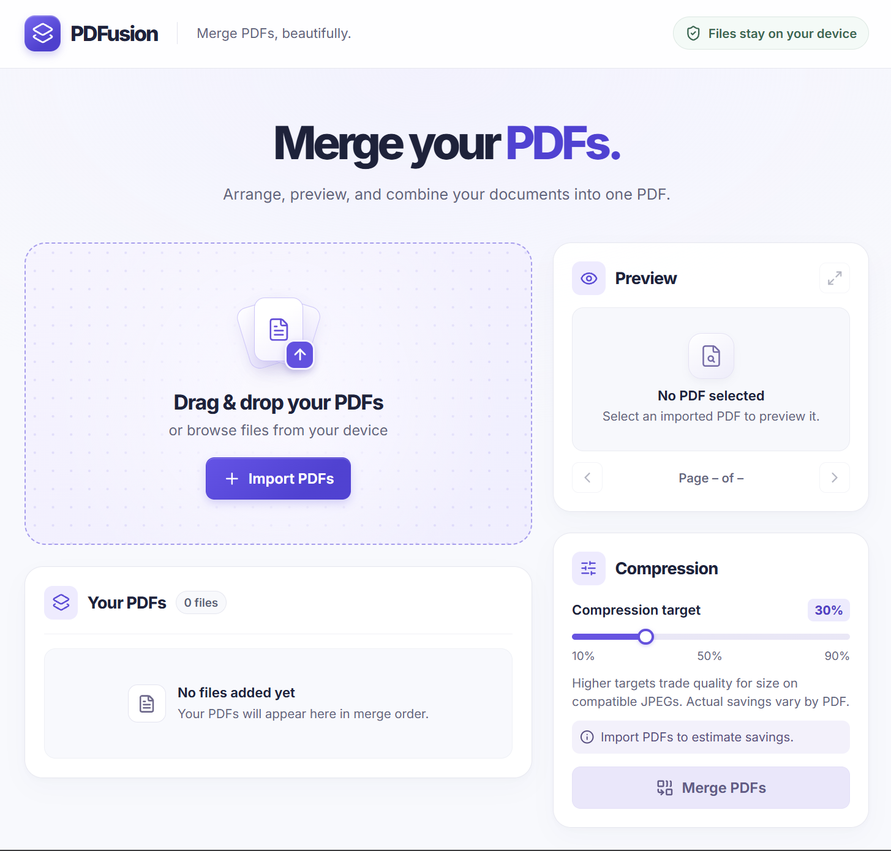

# PDFusion

PDFusion is a local browser app for arranging, previewing, merging, and compressing PDFs. PDF.js renders previews and pdf-lib merges the pages. The development server serves the app and its assets. Files are processed on your device.



## Run locally

Use Node.js 22.13 or newer. From this directory, run:

```sh
npm install
npm run dev
```

Open the local address printed by Vite, typically `http://localhost:5173`. To check a production build, run `npm run build` followed by `npm run preview`.

## Merge PDFs

1. Drop PDFs onto the upload area or choose **Import PDFs**.
2. Arrange the cards left to right. You can drag the grip, use the move buttons, or focus the grip and press the left and right arrow keys.
3. Select a card to browse its pages. Use **Expand PDF preview** to open a larger view.
4. Choose a compression target and select **Merge PDFs**.
5. Edit the output filename and select **Download PDF**.

## Compression and compatibility

The slider applies a quality setting to compatible JPEGs. The estimate samples those images, and the result shows the measured size change. The merge also writes compressed PDF object streams, preserving text and vector graphics. Some PDFs have little room for further compression, and the merged file can be larger than the originals.

PDFusion can prepare a compatible copy of some PDFs that open without a password, including encrypted bank statements. This step runs locally and preserves selectable text. If a PDF requires a password to open, save an unlocked copy before importing. PDFusion merges pages, so document-level features such as bookmarks, attachments, and interactive form behavior may not carry over.
